# DotDash

A set of minimal, sporty UI apps for **BeamNG.drive** - black glass, white and
one red, rev gauges drawn as a single thick line with a needle, and a
start / stop button that carries your car's drivetrain controls.

Thirteen apps, each placed, sized and hidden on its own, or all of it on one
card.

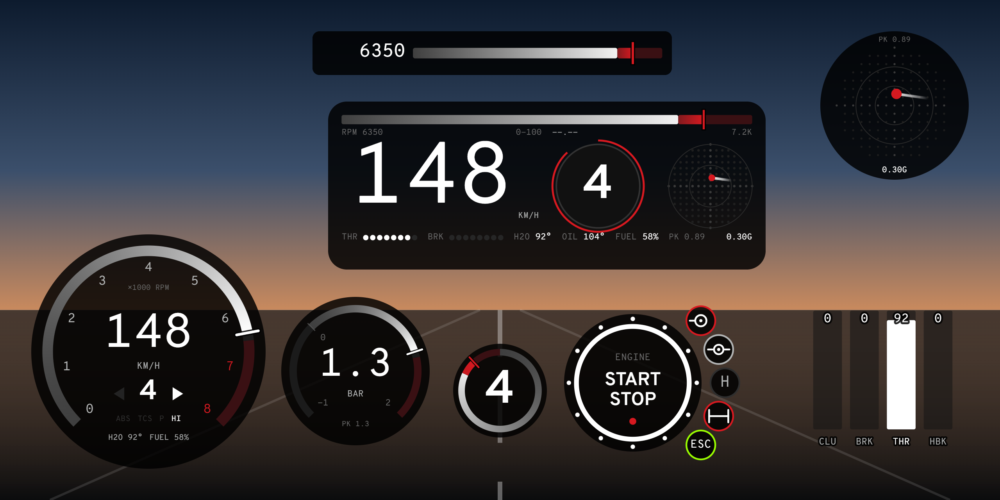

## Install

1. Download `dotdash.zip` from [Releases](../../releases) (or the BeamNG Repository).
2. Put the zip, unopened, into `Documents/BeamNG.drive/mods/`
   (or `%LOCALAPPDATA%/BeamNG/BeamNG.drive/current/mods/`).
3. Start the game, open **UI Apps**, search **Dot** and add what you want.

Every app resizes freely and redraws sharp at any size.

## The apps

| | |
|---|---|
| 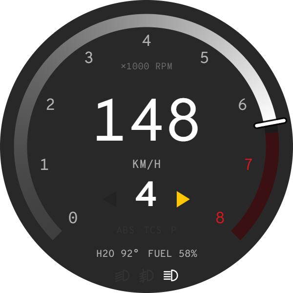 | **DotTacho** - rpm and speed in one round gauge. The revs are one thick line that fades in from idle, with a short needle where the revs are; the redline lights up as you reach it and the whole line flashes at the shift point. Gear, turn signals (in yellow), ABS / TCS / handbrake, low beam / fog / high beam, water and fuel. |
| 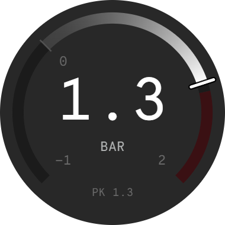 | **DotBoost** - turbo pressure. Vacuum below zero in grey, boost above in white, red near the limit, a red tick holds the peak. |
| 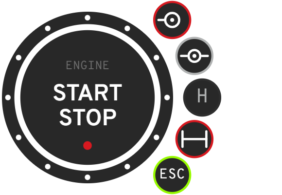 | **DotStartStop** - the engine button: click toggles the ignition, hold to crank. Round it, on a half circle, whatever drivetrain controls your car has, as the game reports them: diff locks (open / LSD / locked), low / high range, 2WD / 4WD, hubs, ESC, drive modes, N2O, JATO. Engaged ones get a red ring; hover for the name. |
|  | **DotRpm** - the rev line on its own, as a bar. |
| 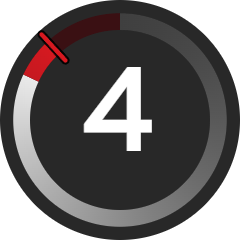 | **DotGearRing** - the gear inside a ring of revs. |
| 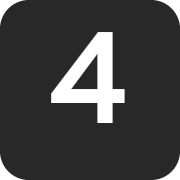 | **DotGear** - just the gear, in a box. |
| 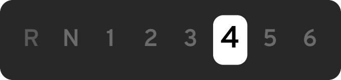 | **DotGears** - every gear of the box on one row: R N 1-6 for manuals and sequentials, P R N D S M for automatics and DCTs (in sport or manual mode the S / M slot carries the gear - S3, M4). Near the limiter the next gear lights red. |
| 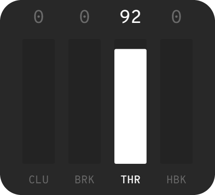 | **DotPedals** - clutch, brake, throttle, handbrake as solid bars with 0-100 %. The brake flickers when ABS works, the throttle when TCS cuts in. |
| 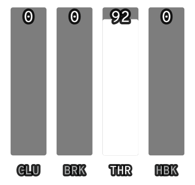 | **DotPedalsClear** - the same with no background and the % inside each bar, outlined to read over any scenery. |
| 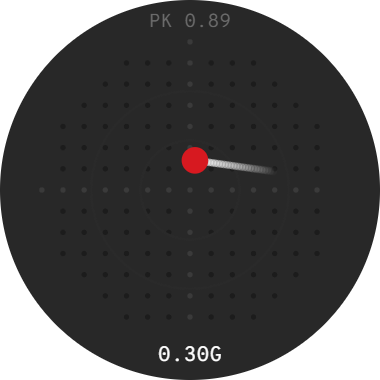 | **DotGMeter** - lateral and longitudinal G, with a trail and the peak. |
| 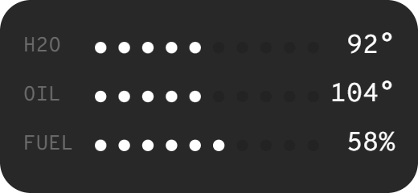 | **DotInfo** - water, oil, fuel. |
| 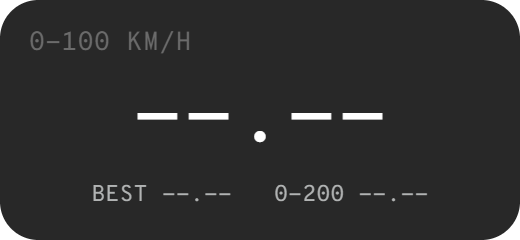 | **DotTimer** - 0-100 and 0-200 km/h (0-60 / 0-120 mph), arming itself whenever you stop; the session best in red. |
| 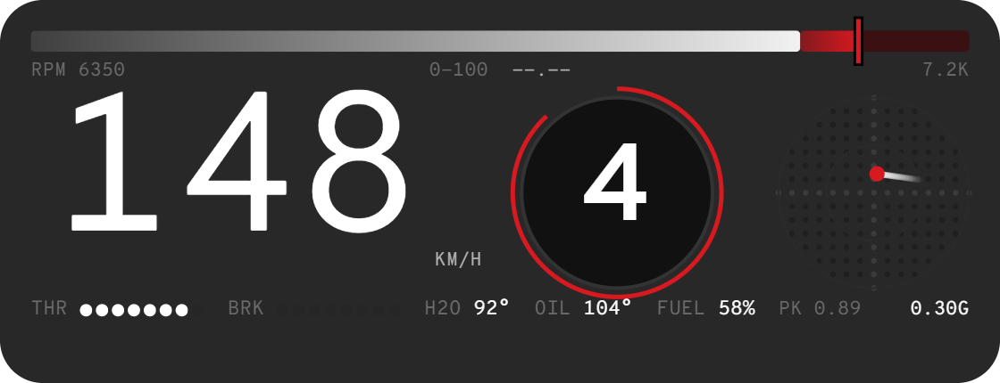 | **DotDash** - everything on one card. |

**Every gearbox reads right**: manual and sequential gears as numbers, automatics and DCTs as P R N D, and in sport / manual mode S1-Sn / M1-Mn - the number big, the mode letter small beside it - on the tacho, the gear box, the gear ring and the combined card.

**Units follow the game's options**: km/h or mph, bar / kPa / psi / inHg,
°C / °F. Warnings stay right whatever is on screen (water over 115 °C is hot
in Fahrenheit too).

## Performance

Each app is one canvas, redrawn only when the game sends new data. Angular
only hosts the canvas - no bindings and no digest per frame - and the parts
that never move are drawn once and reused.

## Building it yourself

```
python build.py --public --zip      # the release zip, dist/dotdash.zip
python build.py                     # build and install into your mods/unpacked
```

`preview.html` runs every widget on a simulated car (launch, a track loop,
idle) with switches for the figure style and the gauge style - serve the
folder (`python -m http.server`) and open it. `test.html` runs the **built**
apps against a fake BeamNG (Angular, StreamsManager, bngApi, UiUnits and the
game's real stream shapes; `?imperial` for mph / psi / °F) to catch adapter
bugs before the game does. `tools/shots_server.py` + `tools/shots.html` make the pictures in
this README from the real renderer.

| | |
|---|---|
| `src/widgets.js` | the separate widgets, one canvas each |
| `src/dash.js` | the combined card |
| `src/numfont.js` | figure styles and the line rev gauges with their needle |
| `src/streams.js` | the game's streams to plain numbers, and the unit conversions |
| `src/apps.js` | one Angular directive per app; the start/stop and drivetrain clicks |
| `build.py` | joins it all into each app's `app.js` |

Data comes from the same streams the stock apps read: `electrics`,
`engineInfo`, `sensors`, `forcedInductionInfo`. The drivetrain buttons come
from the game's own `ui_simplePowertrainControl` extension, so every vehicle
shows exactly what it has.

### Fonts

The release ships no fonts at all: it uses **Overpass** and **Overpass
Mono**, which are already part of BeamNG's UI. For your own copy you can drop
other font files into `fonts/` (names in `build.py`, `FONTS`); a plain
`python build.py` embeds them. Don't share a build that contains fonts you
aren't allowed to redistribute - `--public` leaves them out.

## Credits

Made by Tudor077, with Claude.
